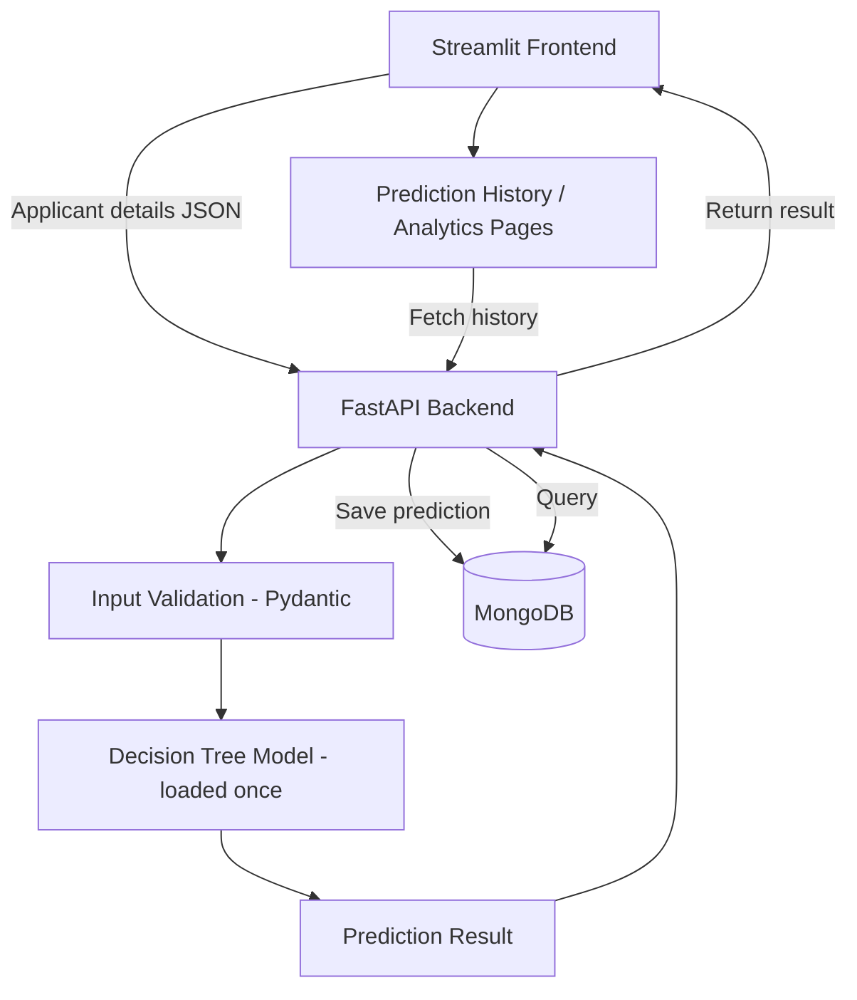

# Loan Intel Desk — AI-Powered Loan Approval Prediction & Financial Insights

A Streamlit dashboard backed by a FastAPI service that scores loan applications with your **existing, unmodified
scikit-learn Decision Tree**, stores every prediction in **MongoDB**, and shows real history, analytics and model insights.

> **Responsible-use disclaimer.** This is a college-seminar demonstration. The model was trained on a *synthetic* dataset whose
> labels come from a hand-written point system plus random noise (see `model/train_model.py`). Its accuracy shows how well the
> tree recovers that rule — **not** how well it predicts real lending outcomes. It has not been independently validated and
> must not be used for real credit decisions. "Predict approve" is a model output, never a guaranteed loan approval.

## Features
- Dashboard: live KPIs, 7/14/30-day trend chart, approve/reject donut, quick-predict shortcut, top feature importances
- Loan Prediction form (13 inputs) → real `predict()` / `predict_proba()` result, 3 financial ratios, application reference, save status
- Prediction History: search by ID, outcome filter, pagination, CSV download
- Analytics: counts, approval %, trends, loan-amount / credit-score / loan-term distributions (Plotly)
- Model Insights: feature importances, **real** test-set metrics, confusion matrix, plain-English feature meanings
- Honest empty states, friendly errors when the API or database is down, "saved / NOT saved" feedback on every prediction

## Architecture

The frontend never touches MongoDB or the model; everything goes through HTTP calls to FastAPI.

## Tech stack
Streamlit · FastAPI · Uvicorn · Pydantic v2 · scikit-learn 1.6.1 (Decision Tree) · Joblib · PyMongo (MongoDB Atlas) · Pandas/NumPy · Plotly · python-dotenv · Requests

## Folder structure
```
LoanIntelDesk/
├── app.py                  Dashboard (home page) - run this with Streamlit
├── ui.py                   Shared theme CSS, sidebar, cards, chart styling   (added)
├── api_client.py           All HTTP calls from Streamlit to FastAPI + friendly errors   (added)
├── pages/                  1_Loan_Prediction, 2_Prediction_History, 3_Analytics, 4_Model_Insights
├── backend/
│   ├── main.py             FastAPI app and endpoints
│   ├── prediction.py       Loads the model once; feature engineering; predict/predict_proba
│   ├── database.py         MongoDB access, indexes, JSON-safe conversion
│   ├── schemas.py          Pydantic request/response models
│   └── analytics.py        Pure functions computing stats from records   (added)
├── model/
│   ├── loan_model.pkl      Your trained model (unchanged)
│   ├── train_model.py      Your training script (+ it now also writes metrics.json)
│   └── metrics.json        Real evaluation metrics (see "Model setup")
├── data/loan_dataset.csv   Your synthetic dataset
├── scripts/seed_demo.py    Optional: pre-fill history for the demo   (added)
├── tests/                  Unit + API tests
├── .streamlit/config.toml  Dark theme
├── .env.example  .gitignore  requirements.txt  README.md
```
Changes from the requested baseline (all additive): `ui.py`, `api_client.py`, `backend/analytics.py`, `scripts/`, `tests/`, `.streamlit/`.
Your original single-file `app.py` logic now lives in `backend/prediction.py` (same formulas, same 16-feature order) and the Loan Prediction page.

## Prerequisites
Windows 10/11, **Python 3.10–3.13** (check: `python --version`), VS Code, and a free MongoDB Atlas account (or local MongoDB).

## Setup & run (Windows, VS Code)
**Terminal A – setup, then FastAPI.** Open the `LoanIntelDesk` folder in VS Code → *Terminal → New Terminal*.
```powershell
python -m venv .venv
.\.venv\Scripts\Activate.ps1
python -m pip install --upgrade pip
pip install -r requirements.txt
copy .env.example .env
```
If PowerShell says *running scripts is disabled*, allow it for this terminal only (no system-wide change):
```powershell
Set-ExecutionPolicy -Scope Process -ExecutionPolicy Bypass
.\.venv\Scripts\Activate.ps1
```
(Or use Command Prompt: `.venv\Scripts\activate.bat`.)

Edit `.env`: set `MONGODB_URI` (next section). Keep `API_BASE_URL=http://127.0.0.1:8000`.

### Model setup
`model/loan_model.pkl` is included — **do not retrain**. It was saved with scikit-learn **1.6.1**, which is why `requirements.txt` pins it.
`model/metrics.json` holds the real test-set evaluation (accuracy 81.3 % on 1,200 held-out rows; confusion matrix; per-class precision/recall).
It was produced by re-running `train_model.py` on your data and verifying the resulting tree is identical to your saved model.
Only if the `.pkl` is missing or corrupt, regenerate both files (this overwrites the model):
```powershell
python model/train_model.py
```

### MongoDB Atlas setup
1. Sign in at <https://cloud.mongodb.com> → create a free **M0** cluster.
2. **Database Access → Add New Database User** → username + password, role *Read and write to any database*. Prefer a password without special characters; if it has any (`@ : / ? #`), URL-encode them.
3. **Network Access → Add IP Address** → *Add Current IP Address* (for a demo venue Wi-Fi you may need *Allow access from anywhere* `0.0.0.0/0` — fine for synthetic data, remove afterwards).
4. **Clusters → Connect → Drivers → Python** → copy the `mongodb+srv://...` string, replace `<password>`, and paste it as `MONGODB_URI` in `.env`.
The database `loan_intel_desk` and collection `predictions` are created automatically on first save, with a unique index on `application_id` and an index on `created_at`.
(Local MongoDB works too: `MONGODB_URI=mongodb://localhost:27017`.)

### Start the backend (Terminal A)
```powershell
uvicorn backend.main:app --reload --host 127.0.0.1 --port 8000
```
Open <http://127.0.0.1:8000/docs>. Try `GET /health` (expect `"status":"ok"`, model and database both true) and `POST /predict` ("Try it out" with the sample body).

### Start the frontend (Terminal B)
*Terminal → New Terminal* (second one), then:
```powershell
.\.venv\Scripts\Activate.ps1
streamlit run app.py
```
Open <http://localhost:8501>. **Terminal A = FastAPI, Terminal B = Streamlit.** Stop either with `Ctrl+C`; restart with the same command.

### Optional: demo data
An empty dashboard is a poor demo. In a third terminal (venv activated):
```powershell
python -m scripts.seed_demo --count 150 --days 7     # add
python -m scripts.seed_demo --clear                   # remove seeded records later
```
Seeded records are real model predictions on rows sampled from your synthetic dataset, backdated over the last 7 days. They are tagged `source: seed_demo`, and the UI says so ("INCLUDES SEEDED DEMO DATA").

## API endpoints
| Method & path | Purpose |
|---|---|
| `GET /health` | `status`, `model_loaded`, `database_connected` |
| `POST /predict` | Validate → engineer 3 ratios → `predict()`+`predict_proba()` → save → return result, ratios, `application_id`, `storage.saved`, range warnings |
| `GET /history?page=&page_size=&status=approved\|rejected&search=` | Paginated, newest first (summary fields only) |
| `GET /history/{application_id}` | One full stored record (404 if unknown) |
| `GET /analytics?days=7` | Totals, approval rate, daily trend, distributions |
| `GET /model-info` | Model type, feature names, hyperparameters, feature importances, metrics |

Status codes: `422` invalid input · `404` unknown ID · `503` model not loaded / database unavailable · `500` unexpected (generic message, details only in the server log).
If MongoDB is down, `/predict` still returns the prediction but with `storage.saved = false` and a clear message.

## Testing
```powershell
python -m pytest -v          # or: python -m unittest discover -s tests -t .
```
Covers: model schema & feature order, engineered ratios, zero/negative divisors, probabilities in [0,1], parity with the original app logic, missing/mismatched model file, analytics on empty and populated data, frontend client behaviour (connection refused, timeout, 422, 503, invalid JSON), and API endpoints (health, valid prediction, missing fields, invalid credit score / negative loan / zero income, history, DB-down, empty DB) using an in-memory store instead of MongoDB.

## Validation checklist (before the seminar)
- [ ] `/health` shows model and database true
- [ ] `/predict` in `/docs` returns a result with `"saved": true`; the document is visible in Atlas → Browse Collections
- [ ] Submit a form in Streamlit → result card + probabilities + ratios + reference ID + green "saved" message
- [ ] Prediction History shows it; Analytics counts increased; refresh the browser tab and restart Streamlit → history is still there
- [ ] Stop Terminal A → Streamlit pages show a friendly "Cannot reach the backend" message; restart it → everything recovers
- [ ] Visually compare the dashboard with your reference image and tweak colours in `ui.py` if desired

## Common errors
| Symptom | Fix |
|---|---|
| `Activate.ps1 cannot be loaded` | `Set-ExecutionPolicy -Scope Process -ExecutionPolicy Bypass`, then activate again |
| `ModuleNotFoundError` | venv not activated in that terminal, or `pip install -r requirements.txt` not run |
| `InconsistentVersionWarning` / model won't load | scikit-learn isn't 1.6.1 → `pip install scikit-learn==1.6.1` |
| Sidebar shows **API offline** | Backend not running or `API_BASE_URL` wrong |
| **DB offline** / "NOT saved" | Wrong `MONGODB_URI`, your IP not in Atlas Network Access, or the Atlas user/password is wrong |
| `ServerSelectionTimeoutError` in the backend log | Same as above; also check venue Wi-Fi isn't blocking port 27017 (try a phone hotspot) |
| `Address already in use` (8000/8501) | Close the old terminal, or use `--port 8001` and set `API_BASE_URL` accordingly |
| Model returns `503` | `model/loan_model.pkl` missing → `python model/train_model.py` |

## Limitations
Synthetic data and labels; accuracy is measured against the synthetic rule, not reality. The tree extrapolates for inputs outside the training range (the API returns a warning). Feature importance ≠ causation. No authentication, no fairness/bias audit, no regulatory compliance — demonstration only.
